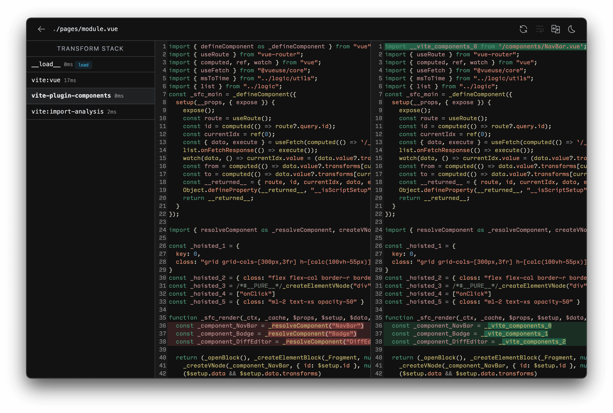

# Plugin API

Vite-Plugins erweitern die gut gestaltete Plugin-Schnittstelle von Rolldown um einige zusätzliche Vite-spezifische Optionen. Dadurch können Sie ein Vite-Plugin einmal schreiben und es sowohl für die Entwicklung als auch für die Erstellung verwenden.

**Es wird empfohlen, zuerst die [Plugin-Dokumentation von Rolldown](https://rolldown.rs/apis/plugin-api) durchzugehen, bevor Sie die unten stehenden Abschnitte lesen.**

## Erstellen eines Plugins

Vite bemüht sich, etablierte Muster von Anfang an anzubieten. Bevor Sie ein neues Plugin erstellen, sollten Sie daher die [Anleitung zu den Funktionen](/guide/features) überprüfen, um zu sehen, ob Ihre Anforderungen bereits abgedeckt sind. Überprüfen Sie auch verfügbare Community-Plugins, sowohl in Form eines [kompatiblen Rollup-Plugins](https://github.com/rollup/awesome) als auch [Vite-spezifischer Plugins](https://github.com/vitejs/awesome-vite#plugins).

Wenn Sie ein Plugin erstellen, können Sie es direkt in Ihrer `vite.config.js` einbetten. Es ist nicht notwendig, ein neues Paket dafür zu erstellen. Wenn Sie feststellen, dass ein Plugin in Ihren Projekten nützlich war, erwägen Sie, es zu teilen, um anderen [in der Community](https://chat.vite.dev) zu helfen.

::: tip
Wenn Sie lernen, Fehler beheben oder Plugins erstellen, empfehlen wir Ihnen, [vite-plugin-inspect](https://github.com/antfu/vite-plugin-inspect) in Ihr Projekt aufzunehmen. Damit können Sie den Zwischenzustand von Vite-Plugins inspizieren. Nach der Installation können Sie `localhost:5173/__inspect/` besuchen, um die Module und Transformationskette Ihres Projekts zu inspizieren. Weitere Installationsanweisungen finden Sie in der [Dokumentation von vite-plugin-inspect](https://github.com/antfu/vite-plugin-inspect).

:::

## Konventionen

Wenn das Plugin keine Vite-spezifischen Hooks verwendet und als [kompatibles Rolldown-Plugin](#rolldown-plugin-kompatibilität) implementiert werden kann, wird empfohlen, die [Rolldown-Plugin-Namenskonventionen](https://rolldown.rs/apis/plugin-api#conventions) zu verwenden.

- Rolldown-Plugins sollten einen klaren Namen mit dem Präfix `rolldown-plugin-` haben.
- Fügen Sie die Schlüsselwörter `rolldown-plugin` und `vite-plugin` im Abschnitt `keywords` in der package.json hinzu.

Dies ermöglicht es, das Plugin auch in reinen Rolldown- oder Rollup-basierten Projekten zu verwenden.

Für ausschließlich Vite-Plugins

- Vite-Plugins sollten einen klaren Namen mit dem Präfix `vite-plugin-` haben.
- Fügen Sie das Schlüsselwort `vite-plugin` im Abschnitt `keywords` in der package.json hinzu.
- Fügen Sie einen Abschnitt in der Plugin-Dokumentation hinzu, der erläutert, warum es sich um ein Vite-spezifisches Plugin handelt (zum Beispiel verwendet es Vite-spezifische Plugin-Hooks).

Wenn Ihr Plugin nur für ein bestimmtes Framework funktionieren soll, sollte dessen Name als Teil des Präfixes enthalten sein.

- `vite-plugin-vue-` Präfix für Vue-Plugins
- `vite-plugin-react-` Präfix für React-Plugins
- `vite-plugin-svelte-` Präfix für Svelte-Plugins

Siehe auch [Konvention für virtuelle Module](https://rolldown.rs/apis/plugin-api#virtual-modules).

## Konfiguration der Plugins

Benutzer werden Plugins zum Projekt `devDependencies` hinzufügen und diese über das `plugins`-Array konfigurieren.

```js [vite.config.js]
import vitePlugin from 'vite-plugin-feature'
import rollupPlugin from 'rollup-plugin-feature'

export default defineConfig({
  plugins: [vitePlugin(), rollupPlugin()],
})
```

Falsche Plugins werden ignoriert, was verwendet werden kann, um Plugins leicht zu aktivieren oder zu deaktivieren.

`plugins` akzeptiert auch Voreinstellungen, die mehrere Plugins als einzelnes Element enthalten. Dies ist nützlich für komplexe Funktionen (wie Framework-Integrationen), die mit mehreren Plugins implementiert werden. Das Array wird intern abgeflacht.

```js
// framework-plugin
import frameworkRefresh from 'vite-plugin-framework-refresh'
import frameworkDevtools from 'vite-plugin-framework-devtools'

export default function framework(config) {
  return [frameworkRefresh(config), frameworkDevTools(config)]
}
```

```js [vite.config.js]
import { defineConfig } from 'vite'
import framework from 'vite-plugin-framework'

export default defineConfig({
  plugins: [framework()],
})
```

## Einfache Beispiele

:::tip
Es ist eine gängige Konvention, ein Vite/Rolldown-Plugin als Factory-Funktion zu erstellen, die das eigentliche Plugin-Objekt zurückgibt. Die Funktion kann Optionen akzeptieren, die es Benutzern ermöglichen, das Verhalten des Plugins anzupassen.
:::

### Transformation von benutzerdefinierten Dateitypen

```js
const fileRegex = /\.(my-file-ext)$/

export default function myPlugin() {
  return {
    name: 'transform-file',

    transform: {
      filter: {
        id: fileRegex,
      },
      handler(src, id) {
        return {
          code: compileFileToJS(src),
          map: null, // Karteninformationen bereitstellen, falls verfügbar
        }
      },
    },
  }
}
```

### Importieren einer virtuellen Datei

Virtuelle Module ermöglichen es, Build-Zeit-Informationen mit normaler ESM-Importsyntax an die Quelldateien zu übergeben. Die vollständige Konvention finden Sie unter [Konvention für virtuelle Module](https://rolldown.rs/apis/plugin-api#virtual-modules).

```js
import { exactRegex } from '@rolldown/pluginutils'

export default function myPlugin() {
  const virtualModuleId = 'virtual:my-module'
  const resolvedVirtualModuleId = '\0' + virtualModuleId

  return {
    name: 'my-plugin', // erforderlich, wird in Warnungen und Fehlern angezeigt
    resolveId: {
      filter: { id: exactRegex(virtualModuleId) },
      handler() {
        return resolvedVirtualModuleId
      },
    },
    load: {
      filter: { id: exactRegex(resolvedVirtualModuleId) },
      handler() {
        return `export const msg = "from virtual module"`
      },
    },
  }
}
```

Dies ermöglicht das Importieren des Moduls in JavaScript:

```js
import { msg } from 'virtual:my-module'

console.log(msg)
```

Da `\0` in Vite kein erlaubtes Zeichen in Import-URLs ist, wird eine virtuelle ID `\0{id}` während der Entwicklung im Browser als `/@id/__x00__{id}` codiert. Die ID wird vor dem Eintritt in die Plugin-Pipeline zurückdekodiert, sodass dies vom Plugin-Hook-Code nicht gesehen wird.

## Rolldown-Hooks {#rolldown-hooks}

Alle Rolldown-Hooks sind [Hooks pro Umgebung](/guide/api-environment-plugins#per-environment-hooks-and-global-hooks).

Während der Entwicklung erstellt der Vite-Dev-Server einen Plugin-Container, der die [Rolldown Build Hooks](https://rolldown.rs/apis/plugin-api#build-hooks) auf dieselbe Weise aufruft, wie es Rolldown tut.

Die folgenden Hooks werden einmal beim Start des Servers aufgerufen:

- [`options`](https://rolldown.rs/reference/Interface.Plugin#options)
- [`buildStart`](https://rolldown.rs/reference/Interface.Plugin#buildstart)

Die folgenden Hooks werden bei jeder eingehenden Modulanforderung aufgerufen:

- [`resolveId`](https://rolldown.rs/reference/Interface.Plugin#resolveid)
- [`load`](https://rolldown.rs/reference/Interface.Plugin#load)
- [`transform`](https://rolldown.rs/reference/Interface.Plugin#transform)

Diese Hooks haben auch eine erweiterte `options`-Parameter mit zusätzlichen Vite-spezifischen Eigenschaften. Weitere Informationen finden Sie in der [SSR-Dokumentation](/guide/ssr#ssr-specific-plugin-logic).

Einige `resolveId`-Aufrufe können `importer` als absoluten Pfad für eine generische `index.html` im Stamm haben, da es nicht immer möglich ist, den tatsächlichen Importeur aufgrund des unbündelten Dev-Server-Musters von Vite abzuleiten. Für Imports, die innerhalb der Vite-Auflösungspipeline verarbeitet werden, kann der Importeur während der Importanalyse verfolgt werden, um den korrekten `importer`-Wert bereitzustellen.

Die folgenden Hooks werden aufgerufen, wenn der Server geschlossen wird:

- [`buildEnd`](https://rolldown.rs/reference/Interface.Plugin#buildend)
- [`closeBundle`](https://rolldown.rs/reference/Interface.Plugin#closebundle)

Beachten Sie, dass der Hook [`moduleParsed`](https://rolldown.rs/reference/Interface.Plugin#moduleparsed) **nicht** während der Entwicklung aufgerufen wird, da Vite aus Leistungsgründen vollständige AST-Analysen vermeidet.

[Hooks zur Ausgabenerzeugung](https://rolldown.rs/apis/plugin-api#output-generation-hooks) (außer `closeBundle`) werden **nicht** während der Entwicklung aufgerufen.

## Vite-spezifische Hooks

Vite-Plugins können auch Hooks bereitstellen, die speziell für Vite-Zwecke dienen. Diese Hooks werden von Rollup ignoriert.

### `config`

- **Typ:** `(config: UserConfig, env: { mode: 'build' | 'serve', command: string, isSsrBuild?: boolean, isPreview?: boolean }) => UserConfig | null | void`
- **Art:** `async`, `sequential`
- **Geltungsbereich:** [Global](/guide/api-environment-plugins#per-environment-hooks-and-global-hooks)

  Ändert die Vite-Konfiguration, bevor sie aufgelöst wird. Der Hook empfängt die Rohkonfiguration des Benutzers (CLI-Optionen zusammengeführt mit der Konfigurationsdatei) und die aktuelle Konfigurationsumgebung, die den verwendeten `mode` und `command` angibt. Er kann ein teilweises Konfigurationsobjekt zurückgeben, das tief in die vorhandene Konfiguration eingefügt wird, oder die Konfiguration direkt ändern (wenn das Standardzusammenführen das gewünschte Ergebnis nicht erreichen kann).

  **Beispiel:**

  ```js
  // Teilweise Konfiguration zurückgeben (empfohlen)
  const partialConfigPlugin = () => ({
    name: 'return-partial',
    config: () => ({
      resolve: {
        alias: {
          foo: 'bar',
        },
      },
    }),
  })

  // Die Konfiguration direkt ändern (nur verwenden, wenn das Zusammenführen nicht funktioniert)
  const mutateConfigPlugin = () => ({
    name: 'mutate-config',
    config(config, { command }) {
      if (command === 'build') {
        config.root = 'foo'
      }
    },
  })
  ```

  ::: warning Hinweis
  Benutzerdefinierte Plugins werden vor der Ausführung dieses Hooks aufgelöst. Das Einbringen anderer Plugins innerhalb des `config`-Hooks hat daher keine Auswirkungen.
  :::

### `configResolved`

- **Typ:** `(config: ResolvedConfig) => void | Promise<void>`
- **Art:** `async`, `parallel`
- **Geltungsbereich:** [Global](/guide/api-environment-plugins#per-environment-hooks-and-global-hooks)

  Wird aufgerufen, nachdem die Vite-Konfiguration aufgelöst wurde. Verwenden Sie diesen Hook, um die endgültige aufgelöste Konfiguration zu lesen und zu speichern. Er ist auch nützlich, wenn das Plugin basierend auf dem ausgeführten Befehl etwas anderes tun muss.

  **Beispiel:**

  ```js
  const examplePlugin = () => {
    let config

    return {
      name: 'read-config',

      configResolved(resolvedConfig) {
        // Die aufgelöste Konfiguration speichern
        config = resolvedConfig
      },

      // Verwenden Sie die gespeicherte Konfiguration in anderen Hooks
      transform(code, id) {
        if (config.command === 'serve') {
          // dev: Plugin, das vom Dev-Server aufgerufen wird
        } else {
          // build: Plugin, das von Rollup aufgerufen wird
        }
      },
    }
  }
  ```

  Beachten Sie, dass der Wert von `command` in der Entwicklung 'serve' ist (in der CLI sind 'vite', 'vite dev' und 'vite serve' Aliase).

### `configureServer`

- **Typ:** `(server: ViteDevServer) => (() => void) | void | Promise<(() => void) | void>`
- **Art:** `async`, `sequential`
- **Geltungsbereich:** [Global](/guide/api-environment-plugins#per-environment-hooks-and-global-hooks)
- **Siehe auch:** [ViteDevServer](./api-javascript#vitedevserver)

  Hook zur Konfiguration des Dev-Servers. Der häufigste Anwendungsfall besteht darin, benutzerdefinierte Middleware zur internen [connect](https://github.com/senchalabs/connect)-App hinzuzufügen:

  ```js
  const myPlugin = () => ({
    name: 'configure-server',
    configureServer(server) {
      server.middlewares.use((req, res, next) => {
        // benutzerdefinierte Anfragen behandeln...
      })
    },
  })
  ```

  **Einfügen von Post-Middleware**

  Der `configureServer`-Hook wird vor der Installation der internen Middlewares aufgerufen, sodass die benutzerdefinierten Middlewares standardmäßig vor den internen Middlewares ausgeführt werden. Wenn Sie eine Middleware **nach** den internen Middlewares einfügen möchten, können Sie eine Funktion aus `configureServer` zurückgeben, die nach der Installation der internen Middlewares aufgerufen wird:

  ```js
  const myPlugin = () => ({
    name: 'configure-server',
    configureServer(server) {
      // Eine Post-Hook zurückgeben, die nach den internen Middlewares aufgerufen wird
      return () => {
        server.middlewares.use((req, res, next) => {
          // benutzerdefinierte Anfragen behandeln...
        })
      }
    },
  })
  ```

  **Speichern des Serverzugriffs**

  In einigen Fällen müssen andere Plugin-Hooks möglicherweise auf die Dev-Server-Instanz zugreifen (z. B. Zugriff auf den WebSocket-Server, den Dateisystem-Watcher oder den Modulgraphen). Dieser Hook kann auch verwendet werden, um die Serverinstanz zur Verwendung in anderen Hooks zu speichern:

  ```js
  const myPlugin = () => {
    let server
    return {
      name: 'configure-server',
      configureServer(_server) {
        server = _server
      },
      transform(code, id) {
        if (server) {
          // Den Server verwenden...
        }
      },
    }
  }
  ```

  Beachten Sie, dass `configureServer` beim Ausführen des Produktionsbuilds nicht aufgerufen wird. Ihre anderen Hooks müssen also gegen dessen Abwesenheit absichern.

### `configurePreviewServer`

- **Typ:** `(server: PreviewServer) => (() => void) | void | Promise<(() => void) | void>`
- **Art:** `async`, `sequential`
- **Geltungsbereich:** [Global](/guide/api-environment-plugins#per-environment-hooks-and-global-hooks)
- **Siehe auch:** [PreviewServer](./api-javascript#previewserver)

  Ähnlich wie [`configureServer`](/guide/api-plugin.html#configureserver), aber für den Vorschau-Server. Ähnlich wie `configureServer` wird der `configurePreviewServer`-Hook vor der Installation anderer Middlewares aufgerufen. Wenn Sie eine Middleware **nach** anderen Middlewares einfügen möchten, können Sie eine Funktion aus `configurePreviewServer` zurückgeben, die nach der Installation der internen Middlewares aufgerufen wird:

  ```js
  const myPlugin = () => ({
    name: 'configure-preview-server',
    configurePreviewServer(server) {
      // Eine Post-Hook zurückgeben, die nach anderen Middlewares aufgerufen wird
      return () => {
        server.middlewares.use((req, res, next) => {
          // benutzerdefinierte Anfragen behandeln...
        })
      }
    },
  })
  ```

### `closeServer`

- **Typ:** `(context: { reason: 'restart' | 'close' }) => void | Promise<void>`
- **Art:** `async`, `parallel`
- **Geltungsbereich:** [Global](/guide/api-environment-plugins#per-environment-hooks-and-global-hooks)

  Wird aufgerufen, wenn der Entwicklungsserver neu gestartet oder geschlossen wird, nachdem der Server heruntergefahren wurde. Wird typischerweise verwendet, um Ressourcen freizugeben, die in [`configureServer`](/guide/api-plugin.html#configureserver) erstellt wurden.

  `context.reason` unterscheidet die beiden Fälle:
  - `'restart'`: Der Server wird neu gestartet (z. B. durch eine Änderung der Konfigurationsdatei oder einen Aufruf von `server.restart()`).
  - `'close'`: Der Server wird beendet (z. B. über das Tastenkürzel `q` oder einen Aufruf von `server.close()`).

  ```js
  const myPlugin = () => {
    let resource
    return {
      name: 'close-server',
      configureServer(server) {
        resource = createResource()
      },
      async closeServer({ reason }) {
        if (reason === 'close') {
          await resource.dispose()
        }
      },
    }
  }
  ```

### `closePreviewServer`

- **Typ:** `() => void | Promise<void>`
- **Art:** `async`, `parallel`
- **Geltungsbereich:** [Global](/guide/api-environment-plugins#per-environment-hooks-and-global-hooks)

  Wie [`closeServer`](/guide/api-plugin.html#closeserver), aber für den Vorschauserver. Der Vorschauserver wird nie neu gestartet, daher gibt es keinen `reason`.

  ```js
  const myPlugin = () => {
    let resource
    return {
      name: 'close-preview-server',
      configurePreviewServer(server) {
        resource = createResource()
      },
      async closePreviewServer() {
        await resource.dispose()
      },
    }
  }
  ```

### `transformIndexHtml`

- **Typ:** `IndexHtmlTransformHook | { order?: 'pre' | 'post', handler: IndexHtmlTransformHook }`
- **Art:** `async`, `sequential`
- **Geltungsbereich:** [Pro Umgebung](/guide/api-environment-plugins#per-environment-hooks-and-global-hooks)

  Dedizierter Hook zur Transformation von HTML-Einstiegspunktdateien wie `index.html`. Der Hook empfängt den aktuellen HTML-String und einen Transformationskontext. Der Kontext gibt während der Entwicklung die [`ViteDevServer`](./api-javascript#vitedevserver)-Instanz und während des Builds das Rollup-Ausgabe-Bundle aus.

  Der Hook kann asynchron sein und kann eines der folgenden zurückgeben:
  - Transformierten HTML-String
  - Ein Array von Tag-Beschreibungsobjekten (`{ tag, attrs, children }`), die in das vorhandene HTML eingefügt werden sollen. Jedes Tag kann auch angeben, wo es eingefügt werden soll (Standard ist die Vorbereitung auf `<head>`)
  - Ein Objekt, das beides als `{ html, tags }` enthält

  Standardmäßig ist `order` `undefined`, wobei dieser Hook nach der Transformation des HTML angewendet wird. Um ein Skript einzufügen, das durch die Vite-Plugins-Pipeline gehen soll, wird `order: 'pre'` den Hook vor der Ver

arbeitung des normalen `<script>`-Tags einfügen.

**Beispiel:**

```js
const htmlPlugin = () => {
  return {
    name: 'html-transform',
    transformIndexHtml(html) {
      return html.replace(
        /<title>(.*?)<\/title>/,
        `<title>Title replaced!</title>`
      )
    },
  }
}
```

**Full Hook Signature:**

```ts
type IndexHtmlTransformHook = (
  html: string,
  ctx: {
    path: string
    filename: string
    server?: ViteDevServer
    bundle?: import('rolldown').OutputBundle
    chunk?: import('rolldown').OutputChunk
    originalUrl?: string
  }
) => IndexHtmlTransformResult | void | Promise<IndexHtmlTransformResult | void>

type IndexHtmlTransformResult =
  | string
  | HtmlTagDescriptor[]
  | {
      html: string
      tags: HtmlTagDescriptor[]
    }

interface HtmlTagDescriptor {
  tag: string
    /**
     * Attributwerte werden bei Bedarf automatisch maskiert
     */
  attrs?: Record<string, string | boolean>
  children?: string | HtmlTagDescriptor[]
  /**
   * default: 'head-prepend'
   */
  injectTo?: 'head' | 'body' | 'head-prepend' | 'body-prepend'
}
```

::: warning Hinweis
Dieser Hook wird nicht aufgerufen, wenn Sie ein Framework verwenden, das eine eigene Handhabung von Eingabedateien nutzt (wie zum Beispiel [SvelteKit](https://github.com/sveltejs/kit/discussions/8269#discussioncomment-4509145)).
:::

### `handleHotUpdate`

- **Typ:** `(ctx: HmrContext) => Array<ModuleNode> | void | Promise<Array<ModuleNode> | void>`
- **Art:** `async`, `sequential`
- **Geltungsbereich:** [Pro Umgebung](/guide/api-environment-plugins#per-environment-hooks-and-global-hooks)
- **Siehe auch:** [HMR API](./api-hmr)

  Führen Sie die benutzerdefinierte HMR-Updateverarbeitung durch. Der Hook erhält ein Kontextobjekt mit folgender Signatur:

  ```ts
  interface HmrContext {
    file: string
    timestamp: number
    modules: Array<ModuleNode>
    read: () => string | Promise<string>
    server: ViteDevServer
  }
  ```
  - `modules` ist ein Array von Modulen, die von der geänderten Datei betroffen sind. Es ist ein Array, weil eine einzelne Datei mehreren bedienten Modulen zugeordnet sein kann (z. B. Vue SFCs).

  - `read` ist eine asynchrone Lese-Funktion, die den Inhalt der Datei zurückgibt. Dies wird bereitgestellt, weil auf einigen Systemen der Dateiänderungs-Callback möglicherweise zu schnell ausgelöst wird, bevor der Editor die Datei fertig aktualisiert hat, und `fs.readFile` leeren Inhalt zurückgibt. Die übergebene Lese-Funktion normalisiert dieses Verhalten.

  Der Hook kann wählen:
  - Die betroffene Modulliste filtern und einschränken, damit HMR genauer ist.

  - Gibt ein leeres Array zurück und führt ein vollständiges Neuladen durch:

    ```js
    handleHotUpdate({ server, modules, timestamp }) {
      // Invalidate modules manually
      const invalidatedModules = new Set()
      for (const mod of modules) {
        server.moduleGraph.invalidateModule(
          mod,
          invalidatedModules,
          timestamp,
          true
        )
      }
      server.ws.send({ type: 'full-reload' })
      return []
    }
    ```

  - Gibt ein leeres Array zurück und führt eine vollständige benutzerdefinierte HMR-Behandlung durch, indem benutzerdefinierte Ereignisse an den Client gesendet werden:

    ```js
    handleHotUpdate({ server }) {
      server.ws.send({
        type: 'custom',
        event: 'special-update',
        data: {}
      })
      return []
    }
    ```

    Der Client-Code sollte den entsprechenden Handler mit der [HMR-API](./api-hmr) registrieren (dies kann durch denselben `transform`-Hook des Plugins injiziert werden):

    ```js
    if (import.meta.hot) {
      import.meta.hot.on('special-update', (data) => {
        // Führen Sie die benutzerdefinierte Aktualisierung durch
      })
    }
    ```

## Metadaten im Plugin-Kontext

Für Plugin-Hooks mit Zugriff auf den Plugin-Kontext stellt Vite zusätzliche Eigenschaften unter `this.meta` bereit:

- `this.meta.viteVersion`: Die aktuelle Vite-Version als String (z. B. `"8.0.0"`).

::: tip Rolldown-basiertes Vite erkennen

[`this.meta.rolldownVersion`](https://rolldown.rs/reference/Interface.PluginContextMeta#rolldownversion) ist nur in Rolldown-basiertem Vite (d. h. Vite 8+) verfügbar. Damit können Sie erkennen, ob die aktuelle Vite-Instanz auf Rolldown basiert:

```ts
function versionCheckPlugin(): Plugin {
  return {
    name: 'version-check',
    buildStart() {
      if (this.meta.rolldownVersion) {
        // nur ausführen, wenn Vite auf Rolldown basiert
      } else {
        // andernfalls ausführen, wenn Vite auf Rollup basiert
      }
    },
  }
}
```

:::

## Metadaten des Ausgabebündels

Während des Builds ergänzt Vite die Build-Ausgabeobjekte von Rolldown mit einem Vite-spezifischen `viteMetadata`-Feld.

Dieses ist verfügbar durch:

- `RenderedChunk` (z. B. in `renderChunk` und `augmentChunkHash`)
- `OutputChunk` und `OutputAsset` (z. B. in `generateBundle` und `writeBundle`)

`viteMetadata` stellt Folgendes bereit:

- `viteMetadata.importedCss: Set<string>`
- `viteMetadata.importedAssets: Set<string>`

Das ist nützlich, wenn Plugins geschrieben werden, die ausgegebene CSS und statische Assets inspizieren müssen ohne von [`build.manifest`](/config/build-options#build-manifest) abhängig zu sein.

Beispiel:

```ts [vite.config.ts]
function outputMetadataPlugin(): Plugin {
  return {
    name: 'output-metadata-plugin',
    enforce: 'post',
    generateBundle(_, bundle) {
      for (const output of Object.values(bundle)) {
        const css = output.viteMetadata?.importedCss
        const assets = output.viteMetadata?.importedAssets
        if (!css?.size && !assets?.size) continue

        console.log(output.fileName, {
          css: css ? [...css] : [],
          assets: assets ? [...assets] : [],
        })
      }
    },
  }
}
```

## Auf ausgegebene Assets verweisen {#referencing-emitted-assets}

Um ein Asset aus einem Plugin auszugeben, rufen Sie [`this.emitFile({ type: 'asset', ... })`](https://rolldown.rs/reference/Interface.PluginContext#in-depth-type-asset) auf. Dies gibt eine `referenceId` zurück, mit der Sie die URL des Assets erzeugen können, da dessen endgültiger Dateiname erst bekannt ist, wenn das Bundle generiert wird.

### In JavaScript {#in-javascript}

Verwenden Sie `import.meta.ROLLDOWN_FILE_URL_<referenceId>`:

```js
const referenceId = this.emitFile({
  type: 'asset',
  name: 'icon.png',
  source: fileContent,
})

// es ist ein JavaScript-Ausdruck, hängen Sie Query oder Hash also per String-Verkettung an
return `export default import.meta.ROLLDOWN_FILE_URL_${referenceId} + '#frag'`
```

### In CSS oder HTML {#in-css-or-html}

`import.meta.ROLLDOWN_FILE_URL_<referenceId>` funktioniert nur an der Position eines JavaScript-Ausdrucks. Verwenden Sie in CSS oder HTML stattdessen das Token `__VITE_ASSET__<referenceId>__` und hängen Sie Query oder Hash direkt dahinter an:

```css
background: url(__VITE_ASSET__<referenceId>__#frag);
```

## Plugin-Reihenfolge

Ein Vite-Plugin kann zusätzlich eine `enforce`-Eigenschaft angeben (ähnlich wie Webpack-Loader), um seine Anwendungsreihenfolge anzupassen. Der Wert von `enforce` kann entweder `"pre"` oder `"post"` sein. Die aufgelösten Plugins werden in folgender Reihenfolge sein:

- Alias
- Benutzer-Plugins mit `enforce: 'pre'`
- Vite-Kern-Plugins
- Benutzer-Plugins ohne `enforce`-Wert
- Vite-Build-Plugins
- Benutzer-Plugins mit `enforce: 'post'`
- Vite-Post-Build-Plugins (minify, manifest, reporting)

Beachten Sie, dass dies unabhängig von der Reihenfolge der Hooks ist, denn diese unterliegen immer noch separat dem [`order`-Attribut](https://rolldown.rs/reference/TypeAlias.ObjectHook#order), wie es für Rolldown-Hooks üblich ist.

## Bedingte Anwendung

Standardmäßig werden Plugins sowohl für den Serve- als auch für den Build-Vorgang aufgerufen. In Fällen, in denen ein Plugin nur während des Serve- oder Build-Vorgangs bedingt angewendet werden muss, verwenden Sie die `apply`-Eigenschaft, um sie nur während `'build'` oder `'serve'` aufzurufen:

```js
function myPlugin() {
  return {
    name: 'build-only',
    apply: 'build', // oder 'serve'
  }
}
```

Eine Funktion kann auch für eine genauere Kontrolle verwendet werden:

```js
apply(config, { command }) {
  // Nur auf den Build anwenden, aber nicht für SSR
  return command === 'build' && !config.build.ssr
}
```

## Rolldown-Plugin-Kompatibilität

Eine beträchtliche Anzahl von Rolldwon-/Rollup-Plugins funktioniert direkt als Vite-Plugin (z. B. `@rollup/plugin-alias` oder `@rollup/plugin-json`), aber nicht alle, da einige Plugin-Hooks in einem nicht gebündelten Dev-Server-Kontext von Vite keinen Sinn ergeben.

Im Allgemeinen sollte ein Rolldown-/Rollup-Plugin als Vite-Plugin funktionieren, solange es folgende Kriterien erfüllt:

- Es verwendet nicht das [`moduleParsed`](https://rolldown.rs/reference/Interface.Plugin#moduleparsed)-Hook.
- Es hat keine starke Kopplung zwischen Bundle-Phase-Hooks und Output-Phase-Hooks.
- Es stützt sich nicht auf die spezifischen Optionen von Rolldown wie [`transform.inject`](https://rolldown.rs/reference/InputOptions.transform#inject).

Wenn ein Rolldown-/Rollup-Plugin nur für die Build-Phase Sinn macht, kann es unter `build.rolldownOptions.plugins` angegeben werden. Es funktioniert genauso wie ein Vite-Plugin mit `enforce: 'post'` und `apply: 'build'`.

Sie können auch ein vorhandenes Rolldown-/Rollup-Plugin mit Vite-spezifischen Eigenschaften erweitern:

```js [vite.config.js]
import example from 'rolldown-plugin-example'
import { defineConfig } from 'vite'

export default defineConfig({
  plugins: [
    {
      ...example(),
      enforce: 'post',
      apply: 'build',
    },
  ],
})
```

## Pfadnormalisierung

Vite normalisiert Pfade, während es IDs auflöst, um POSIX-Trennzeichen ( / ) zu verwenden, während das Volumen in Windows beibehalten wird. Rollup hingegen lässt aufgelöste Pfade standardmäßig unberührt, sodass aufgelöste IDs in Windows Win32-Trennzeichen ( \\ ) haben. Rollup-Plugins verwenden jedoch intern eine [`normalizePath`-Hilfsfunktion](https://github.com/rollup/plugins/tree/master/packages/pluginutils#normalizepath) aus `@rollup/pluginutils`, die Trennzeichen vor dem Vergleich in POSIX umwandelt. Das bedeutet, dass, wenn diese Plugins in Vite verwendet werden, die Muster in der `include`- und `exclude`-Konfiguration sowie andere ähnliche Pfade gegen aufgelöste IDs korrekt funktionieren.

Daher ist es für Vite-Plugins wichtig, Pfade beim Vergleich gegen aufgelöste IDs zuerst zu normalisieren. Eine entsprechende `normalizePath`-Hilfsfunktion wird aus dem `vite`-Modul exportiert.

```js
import { normalizePath } from 'vite'

normalizePath('foo\\bar') // 'foo/bar'
normalizePath('foo/bar') // 'foo/bar'
```

## Filterung, Include-/Exclude-Muster

Vite stellt [`@rollup/pluginutils`'s `createFilter`](https://github.com/rollup/plugins/tree/master/packages/pluginutils#createfilter) Funktion zur Verfügung, um Vite-spezifische Plugins und Integrationen

zur Verwendung des standardmäßigen Include-/Exclude-Filtermusters zu ermutigen, das auch in Vite selbst verwendet wird.

### Hook-Filter

Rolldown hat eine [Hook-Filter-Funktion](https://rolldown.rs/apis/plugin-api/hook-filters) eingeführt, um den Kommunikationsoverhead zwischen Rust und JavaScript zu reduzieren. Dieses Feature ermöglicht Plugins ein Muster festzulegen, dass bestimmt wann Hooks aufgerufen werden. Dadurch werden unnötige Hook-Aufrufe vermieden, was die Performanz verbessert.

Das wird auch von Rollup 4.38.0+ und Vite 6.3.0+ unterstützt. Um Ihr Plugin abwärtskompatibel mit älteren Versionen zu machen, müssen Sie sicherstellen, dass der Filter auch in den Hook-Handlern ausgeführt wird.

```js
export default function myPlugin() {
  const jsFileRegex = /\.js$/

  return {
    name: 'my-plugin',
    // Beispiel: Transform wird nur für .js-Dateien aufgerufen
    transform: {
      filter: {
        id: jsFileRegex,
      },
      handler(code, id) {
        // Zusätzliche Prüfunng für Abwärtskompatibilität
        if (!jsFileRegex.test(id)) return null

        return {
          code: transformCode(code),
          map: null,
        }
      },
    },
  }
}
```

::: tip
[`@rolldown/pluginutils`](https://www.npmjs.com/package/@rolldown/pluginutils) exportiert einige Funktionen für Hook-Filter wie `exactRegex` und `prefixRegex`. Diese werden der Einfachheit halber ebenfalls aus `rolldown/filter` erneut exportiert.
:::

## Informationen zur Chunk-Import-Map

:::info Experimentell

Diese Funktion ist experimentell und kann sich in Zukunft ändern.

:::

Wenn die Option [`build.chunkImportMap`](/config/build-options#build-chunkimportmap) aktiviert ist, verwenden die Import-Anweisungen in den generierten Chunks für jeden Chunk eine eindeutige ID statt des Dateipfads.

Um die Zuordnung von Chunk-ID zu Dateipfad zu erhalten, können Sie in den Hooks `generateBundle` oder `writeBundle` auf die Import Map zugreifen, die in das Bundle ausgegeben wird. Die Import Map trägt den in [`build.rolldownOptions.experimental.chunkImportMap.fileName`](https://rolldown.rs/reference/InputOptions.experimental#chunkimportmap) angegebenen Namen (Standard: `importmap.json`).

```ts
function accessImportMap() {
  let config: ResolvedConfig
  return {
    name: 'access-import-map',
    configResolved(resolvedConfig) {
      config = resolvedConfig
    },
    generateBundle(options, bundle) {
      const chunkImportMap =
        config.build.rolldownOptions.experimental?.chunkImportMap
      if (chunkImportMap) {
        const importMapFilename =
          typeof chunkImportMap === 'object' && chunkImportMap.fileName
            ? chunkImportMap.fileName
            : 'importmap.json'
        const importMap = bundle[importMapFilename]! as OutputAsset
        const mapping = JSON.parse(importMap.source).imports
        console.log(mapping)
        // { "./entry.hash1.js": "./entry.hash2.js" }
      }
    },
  }
}
```

## Kommunikation zwischen Client und Server

Seit Vite 2.9 bieten wir einige Hilfsmittel für Plugins, um die Kommunikation mit Clients zu handhaben.

### Server zu Client

Auf der Plugin-Seite könnten wir `server.ws.send` verwenden, um Ereignisse an den Client zu senden:

```js [vite.config.js]
export default defineConfig({
  plugins: [
    {
      // ...
      configureServer(server) {
        server.ws.on('connection', () => {
          server.ws.send('my:greetings', { msg: 'hello' })
        })
      },
    },
  ],
})
```

:::tip HINWEIS
Wir empfehlen, Ihre Ereignisnamen **immer zu präfixieren**, um Kollisionen mit anderen Plugins zu vermeiden.
:::

Auf der Client-Seite verwenden Sie [`hot.on`](/guide/api-hmr.html#hot-on-event-cb), um auf die Ereignisse zu hören:

```ts
// Client-Seite
if (import.meta.hot) {
  import.meta.hot.on('my:greetings', (data) => {
    console.log(data.msg) // hello
  })
}
```

### Client zu Server

Um Ereignisse vom Client an den Server zu senden, können wir [`hot.send`](/guide/api-hmr.html#hot-send-event-data) verwenden:

```ts
// Client-Seite
if (import.meta.hot) {
  import.meta.hot.send('my:from-client', { msg: 'Hey!' })
}
```

Dann verwenden Sie "server.ws.on" und horchen auf die Ereignisse auf der Serverseite:

```js [vite.config.js]
export default defineConfig({
  plugins: [
    {
      // ...
      configureServer(server) {
        server.ws.on('my:from-client', (data, client) => {
          console.log('Message from client:', data.msg) // Hey!
          // reply only to the client (if needed)
          client.send('my:ack', { msg: 'Hi! I got your message!' })
        })
      },
    },
  ],
})
```

### TypeScript für benutzerdefinierte Ereignisse

Intern leitet Vite den Typ einer Payload vom `CustomEventMap`-Interface ab. Es ist möglich benutzerdefinierte Events durch eine Erweiterung des Interfaces zu typisieren:

:::tip Anmerkung
Stellen Sie sicher, dass Sie bei der Angabe von TypeScript-Deklarationsdateien die Erweiterung `.d.ts` einbeziehen. Andernfalls weiß TypeScript möglicherweise nicht, welche Datei das Modul versucht zu erweitern.
:::

```ts [events.d.ts]
import 'vite/types/customEvent.d.ts'

declare module 'vite/types/customEvent.d.ts' {
  interface CustomEventMap {
    'custom:foo': { msg: string }
    // 'event-key': payload
  }
}
```

Diese Schnittstellenerweiterung wird von `InferCustomEventPayload<T>` genutzt, um den Typ der Payload für das Event `T` abzuleiten. Für mehr Informationen, sehen Sie sich die [HMR-API-Dokumentation](./api-hmr#hmr-api) an.

```ts twoslash
import 'vite/client'
import type { InferCustomEventPayload } from 'vite/types/customEvent.d.ts'
declare module 'vite/types/customEvent.d.ts' {
  interface CustomEventMap {
    'custom:foo': { msg: string }
  }
}
// ---cut---
type CustomFooPayload = InferCustomEventPayload<'custom:foo'>
import.meta.hot?.on('custom:foo', (payload) => {
  // The type of payload will be { msg: string }
})
import.meta.hot?.on('unknown:event', (payload) => {
  // The type of payload will be any
})
```